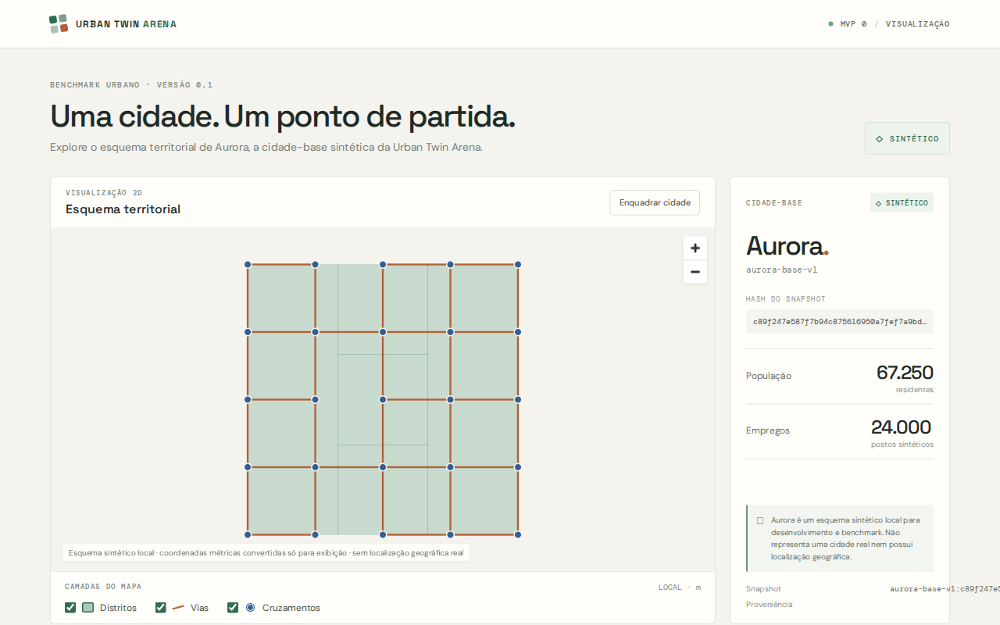
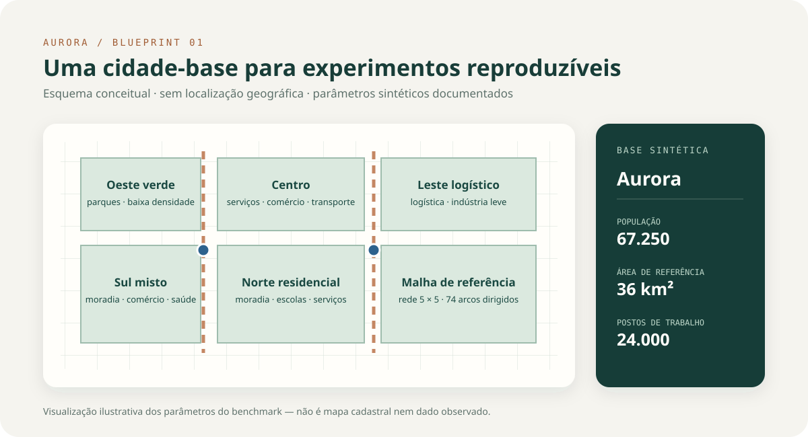
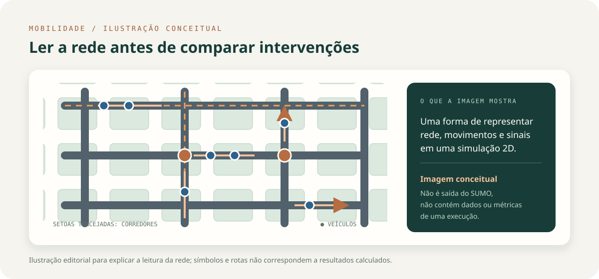
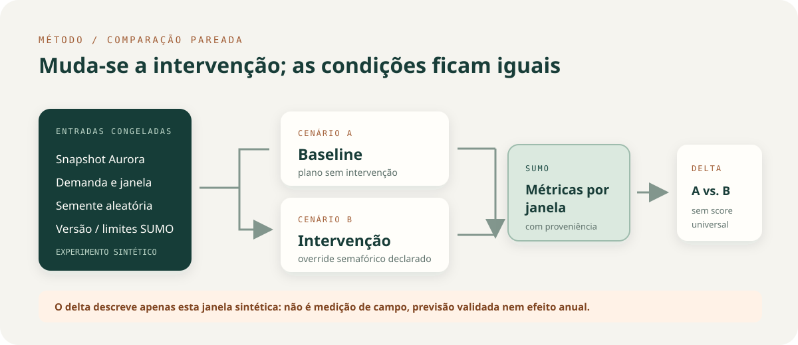

<div align="center">

# Urban Twin Arena

### Um laboratório para explorar decisões urbanas com modelos simuláveis

**Aurora é a cidade-base sintética do projeto.** Aqui construímos e comparamos experiências de mobilidade em condições controladas, com entradas versionadas, execuções reproduzíveis sob a mesma configuração e ambiente, e limites científicos explícitos.


</div>

<p align="center">
  
</p>

<p align="center"><sub>Interface real do projeto. Aurora é um benchmark sintético local; o desenho não representa uma cidade ou localização geográfica real.</sub></p>

---

## O que é

A **Urban Twin Arena** é uma plataforma experimental de planejamento urbano. A ideia é criar cidades digitais versionadas, testar intervenções em modelos computacionais e comparar os resultados antes de considerar qualquer aplicação no mundo real.

O ponto de partida é deliberadamente pequeno: **Aurora**, uma cidade sintética brasileira de referência, com rede viária 2D, demanda por janelas e planos semafóricos configurados. O foco atual é desenvolver o fluxo de simulação, comparação e registro de evidências — não afirmar que já prevemos o trânsito de uma cidade real.

## Aurora em um olhar

| Parâmetro de referência | Valor |
| --- | ---: |
| População sintética | 67.250 residentes |
| Área urbana configurada | 36 km² |
| Postos de trabalho sintéticos | 24.000 |
| Malha viária | grade 5 × 5; 74 arcos direcionados |
| Cruzamentos semaforizados | 2 |
| Identificador da configuração | `aurora-base-v1` |

Os números são parâmetros do benchmark. Parte das proporções usa referências estatísticas nacionais como ponto de partida; os valores de rede, emprego, demanda e semáforos são hipóteses sintéticas, não medições de campo. A fonte versionada é [`configs/cities/aurora-base-v1.yaml`](configs/cities/aurora-base-v1.yaml).

<p align="center">
  
</p>
<p align="center"><sub>Esquema editorial dos parâmetros de Aurora; posições e geometrias são ilustrativas, sem coordenadas geográficas.</sub></p>

## O que já funciona

- **Cidade e mapa 2D:** a API carrega metadados e geometrias da mesma configuração versionada; a interface mostra distritos, vias e cruzamentos sem mapa-base.
- **Simulação de tráfego com SUMO:** o adaptador compila a rede e a demanda sintéticas para uma janela configurada, registra a semente, as versões e os métodos das métricas e permite um período limitado de escoamento.
- **Comparação pareada:** baseline e intervenção usam as mesmas entradas, janela, semente e limites. A API retorna métricas por cenário, deltas e estado de exposição das rotas ao cruzamento alterado.
- **Arena de rodadas anuais sintéticas:** executa políticas determinísticas de benchmark sob o motor anual atual. Elas não são modelos treinados nem agentes autônomos gerais, e a interface não reduz os indicadores a um placar universal.
- **Experimentos pareados multi-semente:** há um protocolo separado para repetir comparações de mobilidade com várias sementes, persistir o experimento e resumir a variação observada.

Esses fluxos ainda são **superfícies experimentais distintas**. Uma métrica SUMO de uma janela não é automaticamente convertida em indicador anual da Arena.

<p align="center">
  
</p>
<p align="center"><sub>Imagem conceitual para explicar a leitura de uma rede simulável; não representa uma execução ou dados de tráfego.</sub></p>

<p align="center">
  
</p>
<p align="center"><sub>Diagrama explicativo do protocolo, não uma captura de execução nem um resultado de tráfego.</sub></p>

## Como interpretar os resultados

> **Estado científico atual:** Aurora, sua demanda e seus parâmetros viários são sintéticos. As execuções do SUMO são resultados simulados para as janelas e condições declaradas. Ainda não há calibração e validação empírica suficientes para prever o desempenho de uma cidade real.

- Uma execução pode mostrar diferenças entre cenários; isso descreve somente aquele benchmark, aquela janela e as condições registradas.
- A comparação pareada controla as entradas declaradas, mas métricas agregadas da rede não isolam o efeito por veículo exposto.
- As métricas de uma janela não são anualizadas. Elas não justificam conclusões sobre população, emissões anuais ou qualidade de vida.
- As políticas de referência são regras determinísticas versionadas, não agentes de IA treinados.
- O projeto não envia comandos para semáforos ou infraestrutura real.

## Começar localmente

### Requisitos

- Python 3.11 ou superior e [`uv`](https://docs.astral.sh/uv/)
- Node.js 20 ou superior
- Para rodar simulações de tráfego: SUMO (`sumo` e `netconvert`) disponível no mesmo ambiente da API

### 1. Instalar e iniciar a API

Na raiz do repositório:

```bash
python -m venv .venv
source .venv/bin/activate
uv pip install --python .venv/bin/python -e ./packages/urban_arena -e ./packages/simulation -e ./apps/api
uvicorn app.main:app --app-dir apps/api --reload
```

A API fica em `http://127.0.0.1:8000`; a documentação interativa fica em [`/docs`](http://127.0.0.1:8000/docs).

Para habilitar o SUMO no ambiente virtual:

```bash
uv pip install --python .venv/bin/python eclipse-sumo
sumo --version
netconvert --version
```

### 2. Iniciar a interface

Em outro terminal:

```bash
cd apps/web
npm install
npm run dev
```

Abra a URL informada pelo Vite (normalmente `http://localhost:5173`). Para detalhes da configuração e dos endpoints, consulte os READMEs da [API](apps/api/README.md), [interface web](apps/web/README.md) e [motor SUMO](packages/simulation/README.md).

## Organização do repositório

```text
apps/
  api/                    API FastAPI e orquestração de experimentos
  web/                    interface React + TypeScript + MapLibre
packages/
  urban_arena/            cidade-base, estado, regras e rodadas anuais
  simulation/             contratos e adaptador do SUMO
configs/cities/           configurações versionadas das cidades
docs/                     arquitetura, especificações e protocolos
```

## Próximos marcos

O trabalho futuro inclui ampliar e auditar o estado urbano, melhorar o vínculo entre ações anuais e evidência de mobilidade, obter dados observados com proveniência e licença verificáveis, e calibrar e validar os modelos em uma região real delimitada. Cada avanço deve declarar cobertura, hipótese, unidade, período e critério de validação.

## Documentação

- [Conceito da Urban Twin Arena](docs/conceito/urban-twin-arena.md)
- [Arquitetura completa](docs/arquitetura/arquitetura-completa-urban-twin-arena.md)
- [Cidade sintética e parâmetros-base](docs/arquitetura/cidade-sintetica-urban-twin-arena.md)
- [Agentes e escopo executável](docs/especificacao/agentes-e-escopo-v1.md)
- [Experimento pareado multi-semente Aurora v1](docs/especificacao/experimento-pareado-multiseed-aurora-v1.md)
- [Catálogo de indicadores](docs/especificacao/catalogo-indicadores-v1.md)

---

<p align="center"><sub>Urban Twin Arena · laboratório de planejamento urbano em desenvolvimento · Aurora sintética</sub></p>
